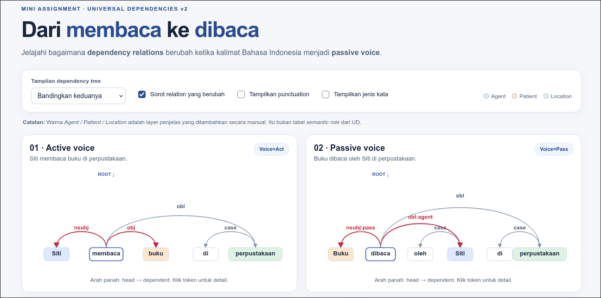

# Laporan Mini Assignment — Universal Dependencies Bahasa Indonesia
*Ini seharusnya laporan_template.md

**Nama / Kelompok:** M Kaka Chadafi F  
**Kelas:** NLP  
**Tanggal:** 28 Oktober 2026

## A. Ringkasan hasil
Pada kedua kasus, *active-passive voice*, setiap entitas(pada kasus ini Siti dan buku) tetap memiliki makna dan peran yang sama walaupun diubah dalam segi tata bahasa. Visualisasi bawaan cukup membantu untuk memahami perbedaan diantara keduanya, terutama dengan visualisasi pohonnya. Dan untuk tugas modifikasi kode, saya menambahkan opsi untuk menampilkan atau menyembunyikan UPOS.

## B. Perbandingan *active–passive voice*

| Semantic role (interpretasi manual) | Active: token + `DEPREL` | Passive: token + `DEPREL` | Apa yang berubah? |
|---|---|---|---|
Agent | Siti → nsubj | Siti → obl:agent | Siti berubah dari subject menjadi keterangan pelaku               |
| Patient | buku → obj | Buku → nsubj:pass | Buku berubah dari object menjadi subject.  |
| Location | perpustakaan → obl | perpustakaan → obl | Tidak ada  |

## C. Jawaban analisis (200–300 kata total)

**C1.** Mengapa `buku` berubah dari `obj` menjadi `nsubj:pass`?
Karena pada kalimat aktif, buku menjadi objek dari membaca. Sedangkan pada kalimat pasif, buku adalah subjek dari dibaca. Keduanya tetap menjadi entitas untuk dibaca. Jadi, secara tata bahasa, buku berubah, namun peran dan maknanya dalam kedua bentuk kalimat tersebut akan sama.

**C2.** Mengapa `Siti` berubah dari `nsubj` menjadi `obl:agent`?
Karena Siti pada kalimat aktif adalah pelaku atau subjek(nsubj) dari "membaca". Sedangkan pada kalimat pasif, Siti menjadi obl:agent(oblique:agent) yakni keterangan pelaku yang membuat buku(subjek pada kalimat pasif) itu "dibaca". Sama seperti buku pada soal sebelumnya, Siti disini tetap menjadi entitas yang melakukan "baca". Secara tata bahasa, Siti memang berubah, namun secara peran dan makna, masih akan sama di kedua kalimat.  

**C3.** Mengapa `di` di “di perpustakaan” menjadi token `case`, tetapi `di-` pada “dibaca” tidak menjadi node sintaksis tersendiri?

Karena secara kepenulisan bahasa indonesia, di yang terpisah menjadi kata depan untuk menunjukkan kata selanjutnya adalah keterangan tempat. Sedangkan di- pada dibaca merupakan prefix yang menunjukkan subjeknya adalah hal yang dikenai aktivitas verb tersebut. 

**C4.** Bagaimana temuan Anda terhubung dengan minimal satu bagian paper (§2.1, §2.2, §2.5, §2.7)?
Mungkin bagian 2.1 tentang *lexicalism*, karena konsep ini cukup berkaitan dengan soal C3. Dalam contoh ini, prinsip *lexicalism* terlihat pada kata "dibaca", di mana prefix "di-" merupakan bagian dari kata tersebut dan tidak dianggap sebagai node sintaksis tersendiri. Hal ini karena *lexicalism* memandang kata utuh sebagai unit dasar dalam hubungan sintaksis, bukan morfem atau imbuhan penyusunnya. Berbeda dengan "di perpustakaan", di mana "di" merupakan kata depan yang berdiri sendiri sehingga memiliki token dan relasi sintaksis case dengan kata "perpustakaan".

## D. Modifikasi kode

**Fitur yang ditambahkan:** Opsi 2 menurut mini_assignment, yakni tambahkan tombol atau opsi untuk menampilkan/menyembunyikan `UPOS` di bawah tiap node. 

**File dan bagian yang diubah:** index.html dan app.js. Pada index.html menambahkan elemen label dan checkbox untuk toggle menampilkan dan menyembunyikan upos, lalu pada app.js lebih ke functional seperti logika if checked dll.

**Hasil pengujian:** Checkbox berhasil menunjukkan/menyembunyikan label UPOS.

**Screenshot before/after:** Before and After:

*contoh pada kasus jenis kata(UPOS) disembunyikan.

## E. Refleksi

Apa satu hal tentang Bahasa Indonesia atau UD yang baru Anda pahami setelah melihat visualisasi?

Secara "Bahasa Indonesia" yang biasa saya kenal, saya selalu menganggap bahwa keterangan tempat seperti pada contoh ini "di perpustakaan" itu cukup independen, hanya tambahan pada kalimat dan lebih terhubung ke frasa sebelumnya secara keseluruhan. Namun ternyata dalam NLP, perpustakaan memiliki head yang langsung ke rootnya yakni verb, baru ke kata lain, bukan langsung terhubung ke keseluruhan frasa.

## F. Referensi

- de Marneffe et al. (2015 revision). [*Universal Dependencies: A cross-linguistic typology*](https://nlp.stanford.edu/~manning/papers/USD_LREC14_UD_revision.pdf).
- [Universal Dependencies — Indonesian-GSD](https://universaldependencies.org/treebanks/id_gsd/index.html).
